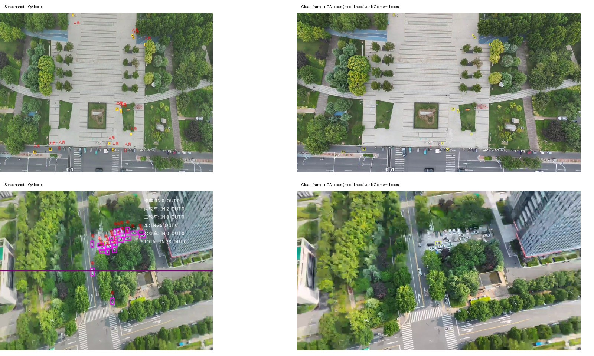

# Luna 补充干净原帧配对实验（2026-10-09）

**结论：补充第四张干净帧有局部收益，但本次尚不能确认它能稳定减少车辆、人员的“看不清”，不足以直接作为发布依据。**

- **车辆：正确率小幅提高，“看不清”降幅很小。** holdout 的 211 个车辆候选，准确率由两次的 **91.9% / 90.5%** 提高到 **93.4% / 92.9%**；真车被驳回从 **13 / 17** 降到 **11 / 11**。但“看不清”仅从 **8 / 12** 变为 **8 / 10**，两次平均只少 1 个。平均准确率提升 1.90 个百分点，其按原片聚类的区间为 −0.27～+4.66；看不清率变化区间也跨过零。dev 车辆两次都改善，但不足以替代 holdout 的不确定性。
- **人员：判断更稳定、准确率提高，但误放仍严重；不能证明减少“看不清”。** holdout 的 52 个候选，准确率由 **38.5% / 48.1%** 提高到 **53.8% / 53.8%**，同组重复结论翻转从 **19 个降到 4 个**。然而 28 个非人员仍有 **20 / 21 个被放过**。“看不清”基线本来就只有 **0 / 1 个**，加干净帧后为 **0 / 0**，没有足够的这类样本证明稳定改善；dev 人员的看不清变化方向还相反（10→0、2→12）。
- **已验证通过的是离线对照的完整性与隔离运行。** 300 张图片、685 个可计分标签、四组共 1,200 次调用全部成功；5 次临时 HTTP 503 已重试成功，无最终调用失败。另有 22 个无二元标签的候选只统计模型结论，不进入准确率。

这并不否定 10-08 的原帧主图实验。它说明：**在本次 p001 和“保留截图前三张、只补第四张”的方式下，收益较有限，尤其没有得到大幅减少看不清的证据。** 本次不是对先前 79 个真车逐个复核，不能把本次减少数量套到那 79 个案例上。


## 问题与对照

检验给 Luna 增加没有平台框线和文字的原帧，是否能减少车辆、人员的“看不清”，以及是否同时改善正确率、真目标被驳回和非目标被放过。

提示词冻结为服务器 `p001`：准备时 `state/best.json` 不存在，按任务指定使用兜底版本。后续自动迭代不改变本次提示词。两组都完整保留 p001 的通用说明和类别卡，仅增加相同的输入坐标说明。请求模型为 `gpt-5.6-luna`，沿用既有实验 worker 的 Codex CLI 调用链；这是使用离线数据的评测，并非本地离线模型推理。

- **截图**：当前实验 worker 的三张图——截图、编号定位图、目标局部裁剪图。
- **截图 + 干净帧**：前三张完全相同，另加第四张无任何绘制标注的原帧。
- 候选中的 `bbox` 是截图归一化坐标，`clean_bbox` 是原帧的归一化投影坐标。两组收到完全相同的提示词和候选信息，只有第四张图是否提供不同。
- 每组运行两次。同一图片的四种条件以固定种子打乱顺序后交错请求。标签、业务编号、原片路径不进入模型请求。
- 沿用线上口径：仅 `true` 放过；`false` 和 `uncertain` 都算驳回。“看不清”单独统计，不与调用失败混淆。

## 输入范围

沿用自动迭代的原始 dev/holdout 划分，未重新抽样或调整标签。

| 范围 | dev | holdout | 合计 |
|---|---:|---:|---:|
| 冻结池图片 | 289 | 137 | 426 |
| 冻结池二元人工标签 | 685 | 443 | 1,128 |
| 可进入本次对照的图片 | 200 | 100 | 300 |
| 可计分二元人工标签 | 376 | 309 | 685 |
| 车辆标签 | 224 | 211 | 435 |
| 人员标签 | 84 | 52 | 136 |

300 张图共保留 707 个候选，其中 22 个没有二元人工标签，不计准确率。主表“看不清”也使用相同的二元金标集合；另补充全部 707 个候选的看不清数量。284 张来自视频、16 张来自原照片。

框架旧 README 中的 735/427 框与服务器实际文件不一致；本次以 `freeze.json` 记录哈希的服务器标签文件为准。服务器 p000 的 dev 计分记录也为 685 框，未用旧文档数量替代实际分母。各类别纳入前后的数量见 [coverage.json](coverage.json)。

单列的 126 张图：96 张未通过快照既有原片匹配质量门槛或缺少对应记录；17 张没有可靠快照对应关系；11 张经文件哈希证明本身就是原片，没有“带标注截图→干净帧”的比较条件；2 张全部候选投影出画。另有 10 个完全出画的候选被排除，其中包含这 2 张图的候选，不能将两项相加当作图片数。具体名单见 [excluded.json](excluded.json)。

## 干净帧与投影检查

仅使用 09-24 快照和服务器已有原片缓存，不访问业务接口，不下载新业务数据。

1. 输入截图必须与快照截图文件哈希完全相同，并且快照的原片匹配已经通过其既有质量门槛。
2. 视频在快照匹配时刻附近 ±1.5 秒用 ffmpeg 流式解码。以快照已验证的无标注对齐帧为参照，先完整投影，再用面积平均缩小后比较相关性。最终使用原始分辨率的帧。
3. 将截图框的四个角通过快照单应矩阵投影到原帧。完全出画的框排除；部分出画保留，并保存裁切前后坐标。
4. 首次准备时发现直接缩小投影会出现纹理混叠，带标注截图的文字也会拉低匹配分。模型调用前已修正并重新生成全部输入，未根据模型结果选择样本。最终视频匹配相关性最低约 0.99963。

图中黄色框仅用于人工核对投影；送给 Luna 的第四张图没有这些黄框。



## 完整配对结果

表内 `① / ②` 表示两次独立调用；准确率按“只有 true 放行”计分。看不清列只统计有二元人工标签的相同候选。

### dev

| 类别（总数/真目标/非目标） | 输入 | 准确率① / ② | 真目标驳回① / ② | 非目标放过① / ② | 看不清① / ② | 其中真目标① / ② |
|---|---|---:|---:|---:|---:|---:|
| 全部（376/278/98） | 截图 | 67.6% / 66.8% | 64 / 58 | 58 / 67 | 42 / 34 | 37 / 30 |
| 全部（376/278/98） | 截图＋干净帧 | 71.8% / 73.4% | 46 / 48 | 60 / 52 | 29 / 38 | 26 / 27 |
| 三轮车（2/0/2） | 截图 | 0.0% / 50.0% | 0 / 0 | 2 / 1 | 0 / 0 | 0 / 0 |
| 三轮车（2/0/2） | 截图＋干净帧 | 50.0% / 50.0% | 0 / 0 | 1 / 1 | 0 / 0 | 0 / 0 |
| 两轮车（6/2/4） | 截图 | 16.7% / 16.7% | 1 / 1 | 4 / 4 | 0 / 1 | 0 / 1 |
| 两轮车（6/2/4） | 截图＋干净帧 | 33.3% / 16.7% | 0 / 1 | 4 / 4 | 0 / 0 | 0 / 0 |
| 人员（84/45/39） | 截图 | 50.0% / 51.2% | 18 / 11 | 24 / 30 | 10 / 2 | 9 / 0 |
| 人员（84/45/39） | 截图＋干净帧 | 50.0% / 60.7% | 11 / 13 | 31 / 20 | 0 / 12 | 0 / 3 |
| 光伏板（0） | 无合格样本 | 无法验证 | — | — | — | — |
| 光斑（0） | 无合格样本 | 无法验证 | — | — | — | — |
| 公交车（3/2/1） | 截图 | 0.0% / 0.0% | 2 / 2 | 1 / 1 | 0 / 1 | 0 / 1 |
| 公交车（3/2/1） | 截图＋干净帧 | 0.0% / 0.0% | 2 / 2 | 1 / 1 | 1 / 1 | 1 / 1 |
| 卡车（7/0/7） | 截图 | 71.4% / 71.4% | 0 / 0 | 2 / 2 | 1 / 1 | 0 / 0 |
| 卡车（7/0/7） | 截图＋干净帧 | 100.0% / 85.7% | 0 / 0 | 0 / 1 | 1 / 0 | 0 / 0 |
| 没戴头盔（2/0/2） | 截图 | 0.0% / 0.0% | 0 / 0 | 2 / 2 | 0 / 0 | 0 / 0 |
| 没戴头盔（2/0/2） | 截图＋干净帧 | 0.0% / 0.0% | 0 / 0 | 2 / 2 | 0 / 0 | 0 / 0 |
| 车（224/202/22） | 截图 | 75.9% / 74.6% | 37 / 38 | 17 / 19 | 30 / 28 | 27 / 27 |
| 车（224/202/22） | 截图＋干净帧 | 79.0% / 79.0% | 29 / 29 | 18 / 18 | 26 / 25 | 24 / 23 |
| 违建（48/27/21） | 截图 | 75.0% / 70.8% | 6 / 6 | 6 / 8 | 1 / 1 | 1 / 1 |
| 违建（48/27/21） | 截图＋干净帧 | 85.4% / 83.3% | 4 / 3 | 3 / 5 | 1 / 0 | 1 / 0 |

### holdout

| 类别（总数/真目标/非目标） | 输入 | 准确率① / ② | 真目标驳回① / ② | 非目标放过① / ② | 看不清① / ② | 其中真目标① / ② |
|---|---|---:|---:|---:|---:|---:|
| 全部（309/260/49） | 截图 | 81.2% / 81.2% | 31 / 28 | 27 / 30 | 11 / 21 | 9 / 18 |
| 全部（309/260/49） | 截图＋干净帧 | 85.4% / 84.5% | 20 / 19 | 25 / 29 | 11 / 12 | 10 / 11 |
| 三轮车（2/1/1） | 截图 | 100.0% / 50.0% | 0 / 1 | 0 / 0 | 1 / 2 | 0 / 1 |
| 三轮车（2/1/1） | 截图＋干净帧 | 50.0% / 0.0% | 1 / 1 | 0 / 1 | 0 / 0 | 0 / 0 |
| 两轮车（8/7/1） | 截图 | 100.0% / 100.0% | 0 / 0 | 0 / 0 | 1 / 1 | 0 / 0 |
| 两轮车（8/7/1） | 截图＋干净帧 | 100.0% / 100.0% | 0 / 0 | 0 / 0 | 1 / 1 | 0 / 0 |
| 人员（52/24/28） | 截图 | 38.5% / 48.1% | 12 / 3 | 20 / 24 | 0 / 1 | 0 / 1 |
| 人员（52/24/28） | 截图＋干净帧 | 53.8% / 53.8% | 4 / 3 | 20 / 21 | 0 / 0 | 0 / 0 |
| 光伏板（0） | 无合格样本 | 无法验证 | — | — | — | — |
| 光斑（0） | 无合格样本 | 无法验证 | — | — | — | — |
| 公交车（0） | 无合格样本 | 无法验证 | — | — | — | — |
| 卡车（3/1/2） | 截图 | 0.0% / 0.0% | 1 / 1 | 2 / 2 | 0 / 1 | 0 / 1 |
| 卡车（3/1/2） | 截图＋干净帧 | 33.3% / 0.0% | 1 / 1 | 1 / 2 | 1 / 0 | 1 / 0 |
| 没戴头盔（0） | 无合格样本 | 无法验证 | — | — | — | — |
| 车（211/205/6） | 截图 | 91.9% / 90.5% | 13 / 17 | 4 / 3 | 8 / 12 | 8 / 12 |
| 车（211/205/6） | 截图＋干净帧 | 93.4% / 92.9% | 11 / 11 | 3 / 4 | 8 / 10 | 8 / 10 |
| 违建（33/22/11） | 截图 | 81.8% / 78.8% | 5 / 6 | 1 / 1 | 1 / 4 | 1 / 3 |
| 违建（33/22/11） | 截图＋干净帧 | 87.9% / 87.9% | 3 / 3 | 1 / 1 | 1 / 1 | 1 / 1 |

### 车辆和人员的重复波动与配对变化

“翻转”包括 true、false、uncertain 之间任意变化。错转对/对转错按业务二元放行口径。区间为按原片聚类、平均两次调用后的 95% bootstrap 区间；准确率差和看不清率差均为“加干净帧 − 截图”，单位为百分点。

| 集合/类别 | 截图重复翻转 | 加干净帧重复翻转 | 错转对①/② | 对转错①/② | 准确率差①/② | 平均准确率差区间 | 平均看不清率差区间 |
|---|---:|---:|---:|---:|---:|---:|---:|
| dev/车 | 20 | 14 | 12/13 | 5/3 | +3.12/+4.46 | +0.77 ~ +7.50 | -3.79 ~ +0.88 |
| dev/人员 | 28 | 18 | 14/17 | 14/9 | +0.00/+9.52 | -3.12 ~ +14.66 | -5.83 ~ +4.93 |
| holdout/车 | 13 | 9 | 6/8 | 3/3 | +1.42/+2.37 | -0.27 ~ +4.66 | -1.82 ~ +0.40 |
| holdout/人员 | 19 | 4 | 14/5 | 6/2 | +15.38/+5.77 | +4.76 ~ +23.68 | -1.56 ~ +0.00 |

### 全部候选的“看不清”补充统计

包括 22 个没有二元人工标签的候选，仅统计模型结论，不计准确率。无候选的类别不把 0 个看不清解释为验证通过。

| 集合/类别（候选数） | 截图① / ② | 截图＋干净帧① / ② |
|---|---:|---:|
| dev/全部（391） | 44 / 36 | 29 / 40 |
| dev/三轮车（3） | 0 / 0 | 0 / 0 |
| dev/两轮车（6） | 0 / 1 | 0 / 0 |
| dev/人员（85） | 10 / 2 | 0 / 13 |
| dev/光伏板（0） | 无候选 | 无候选 |
| dev/光斑（0） | 无候选 | 无候选 |
| dev/公交车（3） | 0 / 1 | 1 / 1 |
| dev/卡车（7） | 1 / 1 | 1 / 0 |
| dev/没戴头盔（2） | 0 / 0 | 0 / 0 |
| dev/车（237） | 32 / 30 | 26 / 26 |
| dev/违建（48） | 1 / 1 | 1 / 0 |
| holdout/全部（316） | 13 / 23 | 14 / 15 |
| holdout/三轮车（3） | 1 / 2 | 0 / 0 |
| holdout/两轮车（8） | 1 / 1 | 1 / 1 |
| holdout/人员（52） | 0 / 1 | 0 / 0 |
| holdout/光伏板（0） | 无候选 | 无候选 |
| holdout/光斑（0） | 无候选 | 无候选 |
| holdout/公交车（0） | 无候选 | 无候选 |
| holdout/卡车（4） | 1 / 1 | 1 / 1 |
| holdout/没戴头盔（0） | 无候选 | 无候选 |
| holdout/车（216） | 9 / 14 | 11 / 12 |
| holdout/违建（33） | 1 / 4 | 1 / 1 |

## 如何解释结果

主表按 dev 和 holdout 分开，且四次全部成功的同一批候选才纳入对照。除准确率外，报告真目标被驳回、非目标被放过、看不清总数和其中的真目标数。

两次重复用于初步估计模型随机波动，同时计算同组结论翻转数、加干净帧后“错转对/对转错”。配对区间以原视频或原照片为簇，对两次结果先取平均，再进行 2,000 次固定种子的 bootstrap。

dev 与 holdout 没有重叠事件和相同截图文件，但共享 37 个原片文件（dev 66 个、holdout 47 个），并有 5 张文件哈希相同的干净图被两边使用。因此 holdout 不是完全独立的新场景验证。部分设计池样本此前参与过提示词设计，也不能把本次结果称为全新外部盲测。

本实验同时改变了输入图数、原始画面信息和分辨率，不能单独将变化归因于“去掉框线”。原片匹配时间是近似时间，相关性与投影不等于逐个移动目标都已人工核验。没有合格样本的类别单列为无法验证。卡车、公交车、两轮车、三轮车和没戴头盔的样本很少，百分比变化不能外推；holdout 车辆仅 6 个非目标，误放风险的估计也很不稳。

10-08 的实验是将主图换成原帧；本次保留截图衍生的前三张图，只补充第四张干净帧。提示词和样本也不同，旧报告的 82%→91% 不能直接当作本次验收线。

## 运行隔离与资源

独立 worker 监听 `127.0.0.1:18398`，最多 4 并发，内存硬上限 4GiB，`memory.swap.max=0`。自动迭代运行时保持 2 个低并发请求；检测到空闲则最多 4 并发。最初采用单并发，确认自动迭代会连续多轮后调整为 2；已完成的调用不重跑，提示词、样本、标签均不变。状态切换时先等待已发出的请求完成，不中断模型请求。

启动初段检查发现用户级 systemd 未获得 CPU 控制器，`CPUQuota=300%` 只有配置值，未形成有效 CPU 硬配额。2026-10-09 17:18:23 的检查记录确认已补上有效的 CPU 亲和性限制；不能声称此前已全程落实三核上限。已对本次 worker 及全部现有线程、子进程应用 CPU 61–63 的亲和性限制，实际最多使用 3 个逻辑 CPU；后续子进程继承。runner 和监控各限一个逻辑 CPU。未修改宿主的 CPU 控制器委派配置。详见 [effective-worker-limits.json](effective-worker-limits.json) 和资源采样记录。

共享 worker 18396、自动迭代 worker 18397、Java 和测试配置均未更改。后台监控在评测结束或资源门槛失守时只停止本次 worker。

## 文件与复现

- `protocol.json`、`freeze.json`、`prompt.json`：实验规则、输入哈希与冻结提示词。
- `all-items.json`、`included.json`、`excluded.json`、`labels.json`：原划分、原片对应、投影、纳入排除和标签。
- `results/`：四个条件的逐图结果与调用重试；`per-box.json`、`report.json`：逐框对照与汇总。
- `resource-samples.jsonl`：运行状态与资源记录；`runtime-before.json`：共享服务和工具的初始记录。
- 原帧图片不入库，依据快照、匹配记录和生成脚本可重新提取；保留每张请求图片的 SHA-256。worker 将图片统一转为 RGB、以 JPEG quality=95 写入 CLI 输入，未对第四张图绘制标注；模型服务内部的视觉缩放不在本次核验范围内。

服务器原始输入文件的哈希见 `freeze.json`；归档 JSON 经格式化，文件字节哈希可能不同。`server-export-manifest.json` 记录导出文件哈希，1,217 个服务器证据文件已逐一比对通过。`integrity-audit.json` 记录四组图片集合、逐框对应、1,200 个独立执行标识及重建提示词哈希的核对。最终准备、调度和评分工具提交为 `2a2392b87dd8607b23aa6a9f053faabf05c1254f`；边界测试 8 项通过。

离线重算结果：

```bash
python3 scripts/score_luna_clean_frame.py --evidence data/luna-clean-frame-eval-20261009
PYTHONPATH=scripts python3 -m unittest scripts/test_luna_clean_frame.py -v
```

本次不包含发布，也不构成共享环境发布验收。若后续决定接入，需另行核对 Java 与算法分支的接口、制品和配置，先在独立实例验证，再由用户授权并执行共享发布；回滚应恢复原制品与原截图输入路径。

## 资源清理清单

- **已停止：** 本次准备、排除核对、实验 worker、runner 和监控进程；无保留实验实例，`127.0.0.1:18398` 已关闭。未分配 GPU。
- **已删除：** 服务器专属目录 `/data/workspace/jzheng/luna-clean-frame-eval-20261009`，约 256MiB，含提取原帧、临时请求目录、独立 worker 认证文件及中间日志；先核对导出哈希，再删除。
- **本机已删除：** `/tmp/luna-clean-frame-eval.A62dmF` 的中间输入、临时核对图片和一次性脚本；最终证据已保留。
- **已保留：** 本目录的最终结果、输入与排除清单、两张图的投影核对预览和必要证据；服务器原有 09-24 快照、原片缓存、自动迭代目录均未删除。
- **资源观测：** 328 次采样覆盖 17:10–19:57，worker 记录到的内存峰值约 882MiB，自身 swap 为 0；主机可用内存最低 34.6%。CPU 配额的初段缺口及后续修正见上文，监控期间未发现共享服务重启或不健康。
- **共享服务核对：** 18396 的 Python PID 仍为 `2734982`；算法测试容器启动时间仍为 `2026-10-08T08:28:13.245765359Z`，重启次数为 0、状态 healthy。详见 `runtime-after.json`、`worker-stopped.json`、`cleanup.json`。
- **工作树：** 本次在 `/Users/wangxiaolin/PycharmProjects/review-annotation-platform-luna-clean-frame-eval` 的 `tests/luna-clean-frame-eval` 分支完成；主检出原有改动未暂存或提交。推送并核验远端后移除此临时工作树，最终状态在交付消息中确认。

本次不发布、不修改 Java 或测试配置。没有执行真实任务保存、派发、回写或设备动作，也未将这些动作标记为验证通过。
