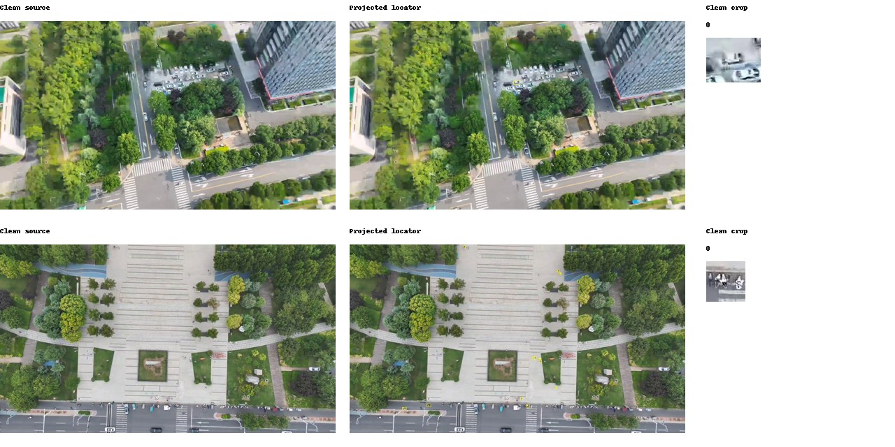

# Luna 全干净原帧三视图离线评测（2026-10-10）

**结论：本批数据上，全干净帧三视图比“截图加第四张干净帧”更有帮助，人员误放有所减少；但车辆看不清的改善只在 holdout 一致出现，人员误放仍高且有波动，不足以直接作为发布依据。**

重点结果如下，每格为两次调用的数量：

| 指标 | 上轮截图三视图 | 上轮截图＋第四张干净帧 | 本轮全干净帧三视图 |
|---|---:|---:|---:|
| holdout 真车看不清（205 个真车候选） | 8 / 12 | 8 / 10 | **5 / 6** |
| dev 真车看不清（202 个真车候选） | 27 / 27 | 24 / 23 | **26 / 23** |
| holdout 人员误放（28 个非人员候选） | 20 / 24 | 20 / 21 | **18 / 10** |
| dev 人员误放（39 个非人员候选） | 24 / 30 | 31 / 20 | **17 / 20** |

- **车辆看不清：有局部改善，尚不能说所有场景都改善。** holdout 两次均少于两组对照，车辆准确率达到 **95.7% / 94.8%**，真车驳回降到 **7 / 9**。但 dev 相比“加第四张”第一次真车看不清多了 2 个，第二次持平。按原片聚类后，holdout 相对纯截图的真车看不清率差区间为 −4.19～−0.63 个百分点，相对“加第四张”为 −3.61～0.00，证据强度不同。
- **人员误放：本批样本改善，但仍不能自动信任。** holdout 相比“加第四张”两次分别少误放 **2 / 11 个**，准确率从 **53.8% / 53.8%** 升至 **59.6% / 73.1%**。但仍放过 28 个非人员中的 18 或 10 个，即 **64.3% / 35.7%**；两次结论翻转 9 个，比“加第四张”的 4 个更多。dev 相比“加第四张”为一次减少 14 个、一次持平。
- **完整性已验证：** 300 张图两次均完成，共 600 个不同执行标识，685 个可计分标签和 22 个无二元标签候选均保持原范围。上一轮四种条件的指标逐项核对一致，未重跑或替换历史结果。

**重要限制：这是跨时段的历史对照，运行中还发生了 CLI 路径失效。** 已保留前 388 次成功结果，后 212 次使用服务器已有的固定版本 CLI 0.155.1。每张图的两次调用都在同一 CLI 阶段内，但不同图片之间工具版本不完全一致；因此不能把本次差异全部归因于去掉平台框线和文字。下方统计区间也不包含这些运行条件变化带来的不确定性。


## 本轮改变了什么

沿用 [10-09 冻结实验](../luna-clean-frame-eval-20261009/README.md) 的 300 张可用图片、原有 dev/holdout 划分、707 个候选及其中 685 个二元人工标签。保持 p001 的通用说明和类别卡；不读取后来出现的最佳版本，不修改标签。

这轮仅新增 `clean_only` 输入，两次共 600 次调用：

1. 第一张是没有平台标注的干净原帧。
2. 第二张在同一干净原帧上画投影框及候选编号。
3. 第三张从无标注的干净原帧按投影框裁剪；保持原 worker 的 25% / 最少 20 像素边距、缩略规则和 JPEG quality=95 转换。

不提供平台截图，不提供第四张图。原帧、框与目标顺序都沿用前一轮；`bbox` 和 `clean_bbox` 均指干净原帧中的投影坐标。仅修改输入坐标说明，p001 的判断规则不变。请求模型仍为 `gpt-5.6-luna`，使用已有 CLI 推理链路。

视频用前一轮记录的解码起点、帧序号与同一解码命令恢复，照片读取已有原片；每张 JPEG 必须与前一轮 `clean_sha256` 一致。恢复失败即停止准备，不重新挑图或缩小集合。前一轮无法用干净帧的 126 张图片及完全出画候选仍单列在原排除清单，不纳入本轮。

## 样本与比较口径

| 范围 | dev | holdout | 合计 |
|---|---:|---:|---:|
| 图片 | 200 | 100 | 300 |
| 可计分人工标签 | 376 | 309 | 685 |
| 车辆标签 | 224 | 211 | 435 |
| 人员标签 | 84 | 52 | 136 |

重点看车辆看不清、真车看不清，以及人员非目标被放过的数量和比例。仅 true 放过，false / uncertain 均驳回；“看不清”不等于接口失败。22 个没有二元人工标签的候选不计准确率，单独统计模型结论。

本轮两次交错运行，固定种子 20261010。分别与上一轮“截图三视图”和“截图三视图加第四张干净帧”的两次结果配对，不重跑带平台截图的对照。比较的是相同图片、相同目标；新旧调用时段不同，不能排除服务端或时间因素，也不把两次重复当成充分的稳定性证明。车辆真目标来自 dev 43 个 / holdout 28 个原片文件，人员非目标来自 dev 12 个 / holdout 10 个原片文件，不能把每一框都当成独立场景。区间按原视频 / 照片聚类，并先平均两次结果。

沿用原有集合意味着 dev / holdout 共享 37 个原片文件和 5 张相同干净图；holdout 不是完全独立的新场景盲测。新输入还同时改变主图分辨率及裁剪上下文，不能将变化只归因于去掉框线。小类别和无合格样本类别不作泛化判断。holdout 车辆只有 6 个非车辆候选，本轮两次均放过 2 个；总体准确率受真车占比很高影响，不能据此宣称车辆误放风险已充分验证。

## 六种条件的完整配对结果

每格 `① / ②` 对应两次独立调用。旧结果原样复用，新旧调用不在同一时段；无样本的类别不报告 0% 准确率。

### dev

| 类别（总数/真目标/非目标） | 输入 | 准确率① / ② | 真目标驳回① / ② | 非目标放过① / ② | 看不清① / ② | 真目标看不清① / ② |
|---|---|---:|---:|---:|---:|---:|
| 全部（376/278/98） | 上轮截图 | 67.6% / 66.8% | 64 / 58 | 58 / 67 | 42 / 34 | 37 / 30 |
| 全部（376/278/98） | 上轮截图＋第四张干净帧 | 71.8% / 73.4% | 46 / 48 | 60 / 52 | 29 / 38 | 26 / 27 |
| 全部（376/278/98） | 本轮全干净帧 | 78.7% / 79.0% | 47 / 44 | 33 / 35 | 32 / 31 | 28 / 25 |
| 三轮车（2/0/2） | 上轮截图 | 0.0% / 50.0% | 0 / 0 | 2 / 1 | 0 / 0 | 0 / 0 |
| 三轮车（2/0/2） | 上轮截图＋第四张干净帧 | 50.0% / 50.0% | 0 / 0 | 1 / 1 | 0 / 0 | 0 / 0 |
| 三轮车（2/0/2） | 本轮全干净帧 | 50.0% / 50.0% | 0 / 0 | 1 / 1 | 0 / 0 | 0 / 0 |
| 两轮车（6/2/4） | 上轮截图 | 16.7% / 16.7% | 1 / 1 | 4 / 4 | 0 / 1 | 0 / 1 |
| 两轮车（6/2/4） | 上轮截图＋第四张干净帧 | 33.3% / 16.7% | 0 / 1 | 4 / 4 | 0 / 0 | 0 / 0 |
| 两轮车（6/2/4） | 本轮全干净帧 | 50.0% / 83.3% | 2 / 0 | 1 / 1 | 2 / 0 | 1 / 0 |
| 人员（84/45/39） | 上轮截图 | 50.0% / 51.2% | 18 / 11 | 24 / 30 | 10 / 2 | 9 / 0 |
| 人员（84/45/39） | 上轮截图＋第四张干净帧 | 50.0% / 60.7% | 11 / 13 | 31 / 20 | 0 / 12 | 0 / 3 |
| 人员（84/45/39） | 本轮全干净帧 | 67.9% / 65.5% | 10 / 9 | 17 / 20 | 1 / 4 | 1 / 2 |
| 光伏板（0） | 无合格样本 | 无法验证 | — | — | — | — |
| 光斑（0） | 无合格样本 | 无法验证 | — | — | — | — |
| 公交车（3/2/1） | 上轮截图 | 0.0% / 0.0% | 2 / 2 | 1 / 1 | 0 / 1 | 0 / 1 |
| 公交车（3/2/1） | 上轮截图＋第四张干净帧 | 0.0% / 0.0% | 2 / 2 | 1 / 1 | 1 / 1 | 1 / 1 |
| 公交车（3/2/1） | 本轮全干净帧 | 66.7% / 33.3% | 1 / 2 | 0 / 0 | 0 / 0 | 0 / 0 |
| 卡车（7/0/7） | 上轮截图 | 71.4% / 71.4% | 0 / 0 | 2 / 2 | 1 / 1 | 0 / 0 |
| 卡车（7/0/7） | 上轮截图＋第四张干净帧 | 100.0% / 85.7% | 0 / 0 | 0 / 1 | 1 / 0 | 0 / 0 |
| 卡车（7/0/7） | 本轮全干净帧 | 100.0% / 85.7% | 0 / 0 | 0 / 1 | 0 / 0 | 0 / 0 |
| 没戴头盔（2/0/2） | 上轮截图 | 0.0% / 0.0% | 0 / 0 | 2 / 2 | 0 / 0 | 0 / 0 |
| 没戴头盔（2/0/2） | 上轮截图＋第四张干净帧 | 0.0% / 0.0% | 0 / 0 | 2 / 2 | 0 / 0 | 0 / 0 |
| 没戴头盔（2/0/2） | 本轮全干净帧 | 50.0% / 50.0% | 0 / 0 | 1 / 1 | 0 / 0 | 0 / 0 |
| 车（224/202/22） | 上轮截图 | 75.9% / 74.6% | 37 / 38 | 17 / 19 | 30 / 28 | 27 / 27 |
| 车（224/202/22） | 上轮截图＋第四张干净帧 | 79.0% / 79.0% | 29 / 29 | 18 / 18 | 26 / 25 | 24 / 23 |
| 车（224/202/22） | 本轮全干净帧 | 81.7% / 83.0% | 30 / 29 | 11 / 9 | 28 / 26 | 26 / 23 |
| 违建（48/27/21） | 上轮截图 | 75.0% / 70.8% | 6 / 6 | 6 / 8 | 1 / 1 | 1 / 1 |
| 违建（48/27/21） | 上轮截图＋第四张干净帧 | 85.4% / 83.3% | 4 / 3 | 3 / 5 | 1 / 0 | 1 / 0 |
| 违建（48/27/21） | 本轮全干净帧 | 87.5% / 87.5% | 4 / 4 | 2 / 2 | 1 / 1 | 0 / 0 |

### holdout

| 类别（总数/真目标/非目标） | 输入 | 准确率① / ② | 真目标驳回① / ② | 非目标放过① / ② | 看不清① / ② | 真目标看不清① / ② |
|---|---|---:|---:|---:|---:|---:|
| 全部（309/260/49） | 上轮截图 | 81.2% / 81.2% | 31 / 28 | 27 / 30 | 11 / 21 | 9 / 18 |
| 全部（309/260/49） | 上轮截图＋第四张干净帧 | 85.4% / 84.5% | 20 / 19 | 25 / 29 | 11 / 12 | 10 / 11 |
| 全部（309/260/49） | 本轮全干净帧 | 89.0% / 90.3% | 13 / 17 | 21 / 13 | 7 / 7 | 7 / 7 |
| 三轮车（2/1/1） | 上轮截图 | 100.0% / 50.0% | 0 / 1 | 0 / 0 | 1 / 2 | 0 / 1 |
| 三轮车（2/1/1） | 上轮截图＋第四张干净帧 | 50.0% / 0.0% | 1 / 1 | 0 / 1 | 0 / 0 | 0 / 0 |
| 三轮车（2/1/1） | 本轮全干净帧 | 50.0% / 50.0% | 1 / 1 | 0 / 0 | 0 / 0 | 0 / 0 |
| 两轮车（8/7/1） | 上轮截图 | 100.0% / 100.0% | 0 / 0 | 0 / 0 | 1 / 1 | 0 / 0 |
| 两轮车（8/7/1） | 上轮截图＋第四张干净帧 | 100.0% / 100.0% | 0 / 0 | 0 / 0 | 1 / 1 | 0 / 0 |
| 两轮车（8/7/1） | 本轮全干净帧 | 87.5% / 87.5% | 1 / 1 | 0 / 0 | 1 / 1 | 1 / 1 |
| 人员（52/24/28） | 上轮截图 | 38.5% / 48.1% | 12 / 3 | 20 / 24 | 0 / 1 | 0 / 1 |
| 人员（52/24/28） | 上轮截图＋第四张干净帧 | 53.8% / 53.8% | 4 / 3 | 20 / 21 | 0 / 0 | 0 / 0 |
| 人员（52/24/28） | 本轮全干净帧 | 59.6% / 73.1% | 3 / 4 | 18 / 10 | 0 / 0 | 0 / 0 |
| 光伏板（0） | 无合格样本 | 无法验证 | — | — | — | — |
| 光斑（0） | 无合格样本 | 无法验证 | — | — | — | — |
| 公交车（0） | 无合格样本 | 无法验证 | — | — | — | — |
| 卡车（3/1/2） | 上轮截图 | 0.0% / 0.0% | 1 / 1 | 2 / 2 | 0 / 1 | 0 / 1 |
| 卡车（3/1/2） | 上轮截图＋第四张干净帧 | 33.3% / 0.0% | 1 / 1 | 1 / 2 | 1 / 0 | 1 / 0 |
| 卡车（3/1/2） | 本轮全干净帧 | 100.0% / 66.7% | 0 / 1 | 0 / 0 | 0 / 0 | 0 / 0 |
| 没戴头盔（0） | 无合格样本 | 无法验证 | — | — | — | — |
| 车（211/205/6） | 上轮截图 | 91.9% / 90.5% | 13 / 17 | 4 / 3 | 8 / 12 | 8 / 12 |
| 车（211/205/6） | 上轮截图＋第四张干净帧 | 93.4% / 92.9% | 11 / 11 | 3 / 4 | 8 / 10 | 8 / 10 |
| 车（211/205/6） | 本轮全干净帧 | 95.7% / 94.8% | 7 / 9 | 2 / 2 | 5 / 6 | 5 / 6 |
| 违建（33/22/11） | 上轮截图 | 81.8% / 78.8% | 5 / 6 | 1 / 1 | 1 / 4 | 1 / 3 |
| 违建（33/22/11） | 上轮截图＋第四张干净帧 | 87.9% / 87.9% | 3 / 3 | 1 / 1 | 1 / 1 | 1 / 1 |
| 违建（33/22/11） | 本轮全干净帧 | 93.9% / 93.9% | 1 / 1 | 1 / 1 | 1 / 0 | 1 / 0 |

### 重点指标的配对变化

差值均为“本轮全干净帧 − 对照”，区间为按原视频 / 原照片聚类、平均两次后的 95% bootstrap 区间。看不清或误放减少时为负值。区间不包含跨时段服务变化的不确定性。

| 集合 | 对照 | 真车看不清变化① / ② | 真车看不清率差区间（百分点） | 人员误放变化① / ② | 平均人员误放率差（百分点） | 人员误放率差区间（百分点） |
|---|---|---:|---:|---:|---:|---:|
| dev | 上轮截图 | -1 / -4 | -4.80 ~ +2.33 | -7 / -10 | -21.79 | -58.82 ~ -2.53 |
| dev | 上轮截图＋第四张干净帧 | +2 / +0 | -2.68 ~ +3.42 | -14 / +0 | -17.95 | -50.00 ~ +1.00 |
| holdout | 上轮截图 | -3 / -6 | -4.19 ~ -0.63 | -2 / -14 | -28.57 | -68.75 ~ -3.12 |
| holdout | 上轮截图＋第四张干净帧 | -3 / -4 | -3.61 ~ +0.00 | -2 / -11 | -23.21 | -40.74 ~ -10.00 |

### 同组两次调用的结论翻转

翻转包括 true、false、uncertain 之间的变化。两次重复只能初步估计波动。

| 集合/类别 | 上轮截图 | 上轮加第四张 | 本轮全干净帧 |
|---|---:|---:|---:|
| dev/车 | 20（8.9%） | 14（6.2%） | 7（3.1%） |
| dev/人员 | 28（33.3%） | 18（21.4%） | 15（17.9%） |
| holdout/车 | 13（6.2%） | 9（4.3%） | 2（0.9%） |
| holdout/人员 | 19（36.5%） | 4（7.7%） | 9（17.3%） |

### 全部候选的看不清补充统计

包括 22 个无二元人工标签的候选；只统计模型结论，不用于准确率。

| 集合/类别（候选数） | 上轮截图① / ② | 上轮加第四张① / ② | 本轮全干净帧① / ② |
|---|---:|---:|---:|
| dev/全部（391） | 44 / 36 | 29 / 40 | 34 / 33 |
| dev/三轮车（3） | 0 / 0 | 0 / 0 | 0 / 0 |
| dev/两轮车（6） | 0 / 1 | 0 / 0 | 2 / 0 |
| dev/人员（85） | 10 / 2 | 0 / 13 | 1 / 4 |
| dev/光伏板（0） | 无候选 | 无候选 | 无候选 |
| dev/光斑（0） | 无候选 | 无候选 | 无候选 |
| dev/公交车（3） | 0 / 1 | 1 / 1 | 0 / 0 |
| dev/卡车（7） | 1 / 1 | 1 / 0 | 0 / 0 |
| dev/没戴头盔（2） | 0 / 0 | 0 / 0 | 0 / 0 |
| dev/车（237） | 32 / 30 | 26 / 26 | 30 / 28 |
| dev/违建（48） | 1 / 1 | 1 / 0 | 1 / 1 |
| holdout/全部（316） | 13 / 23 | 14 / 15 | 8 / 9 |
| holdout/三轮车（3） | 1 / 2 | 0 / 0 | 0 / 0 |
| holdout/两轮车（8） | 1 / 1 | 1 / 1 | 1 / 1 |
| holdout/人员（52） | 0 / 1 | 0 / 0 | 0 / 0 |
| holdout/光伏板（0） | 无候选 | 无候选 | 无候选 |
| holdout/光斑（0） | 无候选 | 无候选 | 无候选 |
| holdout/公交车（0） | 无候选 | 无候选 | 无候选 |
| holdout/卡车（4） | 1 / 1 | 1 / 1 | 0 / 0 |
| holdout/没戴头盔（0） | 无候选 | 无候选 | 无候选 |
| holdout/车（216） | 9 / 14 | 11 / 12 | 6 / 8 |
| holdout/违建（33） | 1 / 4 | 1 / 1 | 1 / 0 |

## 输入核对

以下为实际 worker 图像处理的抽查预览。预览通过拦截模型启动来捕获三张真实输入，没有调用模型，也没有把预览用的占位回答放入评测结果。



## 运行隔离

独立端口 `127.0.0.1:18399`。worker 内存硬上限 4GiB、swap 为 0；CPUQuota=300% 并同时用三核 CPU 亲和性限制，在第一个模型请求前核验有效内存限制及 CPU 集合。用户级 CPU 控制器仍未委派，`CPUQuota` 本身不构成有效配额；本轮从启动起即用 CPU 61–63 亲和性形成实际三核限制，首次启动和恢复后均通过核对。最多 4 并发；检测到原自动迭代运行时降至 2，已有请求正常结束后再降并发。

本轮开始时 GPU 状态查询出现驱动与 NVML 库版本不匹配。这是启动前已有的查询异常；本实验不使用 GPU，未修复或变更驱动。共享测试容器健康及 18396 监听状态单独核验。仅使用服务器已有离线缓存，不连接业务接口或修改共享数据。

## 中断与恢复记录

在完成 388 次成功调用后，配置中的 `/home/user/.vscode-server/extensions/openai.chatgpt-26.1002.51308-linux-x64/bin/linux-x86_64/codex` 文件在运行中消失。16 个请求各重试一次仍失败，共留下 32 次 HTTP 503 执行错误；这不是“看不清”，也未计入准确率。没有确认是谁更新或删除了该路径，不将其归因为模型质量或共享服务故障。

发现连续失败后只对本次 runner 发出中断，等待在途请求结束；监控随后停止本次 worker。认证文件和临时目录存在，共享服务健康。检查服务器已有的 `/home/user/.local/opt/codex-0.155.1/codex-x86_64-unknown-linux-musl`，核对版本、哈希及所需参数兼容后，仅覆盖本次独立 worker 的 CLI 路径。没有安装软件，没有修改共享 worker 配置或原自动迭代配置。

恢复时跳过已成功结果，保留失败尝试并补跑。最终 600 次均成功、无最终失败；前 388 个成功文件的哈希全部不变。194 张图片的两次调用均在原 CLI 阶段，106 张图片均在固定 CLI 阶段，没有单张图片跨两个 CLI 阶段。原扩展 CLI 消失前未记录其二进制哈希和 CLI 版本号，不能补称运行环境完全一致。

证据见 `failure-path-check.json`、`replacement-cli.json`、`resume-history.json`、`successful-before-resume.json`、`cli-phase-units.json` 和逐次 `attempts`。固定 CLI 为服务器原有可复用工具，清理时予以保留。

## 证据与复算

- `protocol.json`：模型调用前冻结的规则、上一轮提交和输入文件哈希。
- `input-manifest.json`：恢复后的原帧哈希、投影坐标及图片尺寸。
- `results/`：新增两次逐图结果、重试状态、调用标识与提示词哈希。
- `report.json`、`per-box.json`：六种条件的逐框配对和汇总；上一轮原始结果不重复复制。
- `runtime-before.json`、`effective-limits.json`、`resource-samples.jsonl`：启动前状态、实际限制与运行资源记录。

完整性核对见 `integrity-audit.json`：617 个服务器证据文件导出哈希一致，600 个新提示词哈希按冻结 p001 和投影坐标重建一致。原始 worker 图像处理代码未改动。工具提交为 `e3fdb8543c8e7e1e4a0ae6743ef2c34fe19f0c2a`，CLI 路径恢复修复为 `f6ce75c1e15df7aed41fa7029c61c353b2a6e3bb`；5 项必要测试通过。

```bash
python3 scripts/score_luna_clean_only.py --evidence data/luna-clean-only-eval-20261010 --baseline data/luna-clean-frame-eval-20261009
PYTHONPATH=scripts python3 -m unittest scripts/test_luna_clean_only.py -v
```

本次仅离线评测，不发布，不改 Java、测试配置或共享服务，不执行真实任务和设备动作。

## 资源清理清单

- **已停止：** 本次 prepare、preview、launch、worker、runner、watch 的进程；`127.0.0.1:18399` 已关闭，无保留实验实例。
- **已删除：** 服务器 `/data/workspace/jzheng/luna-clean-only-eval-20261010`，约 254MiB，含恢复原帧、临时请求图片、专用认证文件、脚本副本与中间日志；先校验最终证据的导出哈希，再删除。
- **本机已删除：** `/tmp/luna-clean-only-eval.hRjxJf` 的监控、临时核对图片及一次性脚本，最终证据已经保留。
- **已保留：** 本目录最终结果、清单、核对预览和必要证据；服务器原有快照、原片、自动迭代目录、账号文件与固定 CLI 均未删除。本轮未申请 GPU。
- **运行观测：** 117 次资源采样覆盖 2026-10-10 09:12–10:11（Asia/Taipei），worker 内存峰值约 937MiB，自身 swap 一直为 0，主机可用内存最低 41.6%。原自动迭代在这些采样中均为空闲；本轮未与其同时高并发运行。
- **共享服务核对：** 18396 的 Python PID 仍为 `2734982`；算法测试容器启动时间仍为 `2026-10-08T08:28:13.245765359Z`，重启次数 0，健康状态未变。启动前已存在的 GPU 状态查询异常未在本任务中修复。
- **工作树：** 复用分支 `tests/luna-clean-frame-eval`，在 `/Users/wangxiaolin/PycharmProjects/review-annotation-platform-luna-clean-frame-eval` 隔离处理；主检出已有改动未暂存或提交。结果推送并核对远端 SHA 后移除此临时工作树，最终状态在交付消息中确认。

本轮结果支持把全干净帧三视图作为后续验证候选，但尚不足以授权共享发布。本次没有发布、修改 Java 或测试配置，也没有执行真实任务或设备动作。
