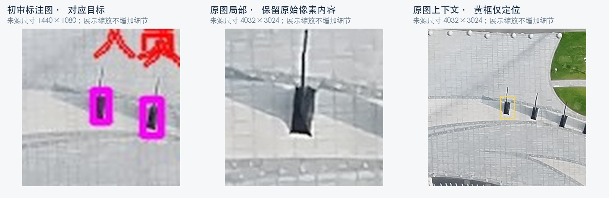

# 原图辅助视觉复检：真假目标核验报告

日期：2026-09-27。当前只读核对时间：10:38:31（UTC+8）。对象：测试环境已检出的人员、车辆候选。

## 一、结论与下一步

**原图辅助复核已经在测试环境生效，已有局部改善的图像证据；尚不能证明总体准确率提升，也不能给出提升百分比。**

1. 此前批量观察中，4 个原先自动确认、图像却支持非目标的候选，变为 1 个驳回、3 个转人工；16 个原先存疑、原图可辨车辆的候选变为确认。
2. 代价是自动判定覆盖率由 79.4% 降至 68.0%（同一批 175 个可配对候选）。5 个可辨车辆仍被支撑面策略转人工，需要优先修正。
3. 最新发布后实测 2 个事件、12 个候选：有原图的 2 个“人员”候选均驳回；缺原图的 10 个候选由旧单图流程确认 4 个、驳回 6 个。两事件逐框结论均与发布前相同。
4. **本次知眸回调改动补齐的是原图保存与映射，未更换模型权重。** 新自然回调从原图落库到复核的完整链路仍待验收，不能把此前批量改善归因于今天这次回调接入。

建议先验收新回调的原图来源，再修正过度转人工的场景，最后在同一批新事件上做有原图/无原图对照。暂不开始新一轮训练；先把可用原图和真实目标定位做稳定，才有依据选择训练样本。

## 二、核验范围

| 范围 | 数量 | 证据时间和含义 |
|---|---:|---|
| 当前只读回查 | 37 事件 | 2026-09-27 10:38:31；均为复核完成 |
| 此前原图批次 | 36 事件 / 180 候选 | 保存结果混合 v6/v7/v8；今天逐框结论回查全部相同 |
| 有历史结论可配对 | 175 候选 | 其余 5 个不进入前后比例分母 |
| 有效定位且有图像核查记录 | 143 候选 | 2026-09-26 Codex 图像核查；本报告复看典型案例 |
| 定位或画面匹配未通过 | 37 候选 | 不强行给出真假观察结论 |
| 最新发布后实际复测 | 2 事件 / 12 候选 | 2026-09-27 10:25、10:26 完成 |

最新 12 个候选中的 2 个已包含在此前 180 个中，不能简单相加为 192。去重后本报告涉及 37 个事件、190 个候选；前后效果统计仍只用原 175 个配对候选。今天的回查是读取保存结果，没有把 36 个事件统一重跑为 v8。

所有“目视支持目标/非目标”均为 Codex 图像解释，不是用户确认或独立人工真值。本报告不使用历史人工金标评分，不把模型一致当作真值；本报告新取得的用户逐框确认数为 0。

## 三、发布后实测

| 事件 | 新复核时间 | 原图证据 | 模型最终输出 |
|---|---|---|---|
| Event-20260723105651-5 | 09-27 10:25:09 | 1440×1080 初审图映射 4032×3024 原图；2 框原图路径均生效 | 0 确认、2 驳回、0 存疑 |
| Event-20260923180729 | 09-27 10:26:05 | 没有可用清晰原图；继续单图流程 | 4 确认、6 驳回、0 存疑 |

### 3.1 高清原图事件：固定杆件被当作人员送检



| 框 | 初审类别 | 初审图上的实际轮廓范围（像素） | 本次原图复核 | 图像观察 |
|---|---|---|---|---|
| 1 | 人员 | [723,157,735,176] | 驳回 | 广场弧线上重复排列的杆件和底部结构，支持非人员 |
| 2 | 人员 | [745,161,758,182] | 驳回 | 同一排列中的固定杆件，支持非人员 |

两框均有 `cleanSource.applied=true`、画面匹配通过，以及初审上下文、初审局部、原图上下文、原图局部四视图证据。Qwen3-VL 基础模型与适配器均输出 REJECTED。匹配分数 0.99254 表示画面对应程度，**不是分类置信度或准确率**。

这里展示的裁切和缩放用于核验，未生成或补画目标细节；它们不是模型内部四视图张量的原样导出。初审图保留已有标记；原图上下文黄框仅用于展示定位。

该事件发布前已经是两框驳回，所以它证明高清原图链路和结果持久化正常，不构成新增纠错数量。模型执行记录约 92.14 秒；单事件耗时不能代表服务吞吐量或延迟分布。

### 3.2 缺原图事件：验证兼容行为

人员候选 1 至 10 的结果依次为：**驳回、确认、确认、驳回、确认、驳回、驳回、驳回、确认、驳回**。

理由为 `crop_verifier_true/false`，没有原图生效证据。这 4 个确认只表示模型输出，本报告未将其计入“已核验真目标”。此事件也与发布前逐框结论相同。历史附件仍是同一份 960×720 标注图，不能当作清晰原图使用。

## 四、此前原图改动的效果观察

### 4.1 配对候选的结果变化

| 指标 | 历史结果 | 改动后保存结果 | 变化 |
|---|---:|---:|---:|
| 自动确认 | 135 / 77.1% | 112 / 64.0% | -23 |
| 自动驳回 | 4 / 2.3% | 7 / 4.0% | +3 |
| 存疑 / 人工 | 36 / 20.6% | 56 / 32.0% | +20 |
| 自动判定覆盖率 | 139/175 = 79.4% | 119/175 = 68.0% | -11.4 个百分点 |

自动判定覆盖率 =（确认 + 驳回）/ 配对候选数，**不等于准确率**。全量 180 候选为确认 112、驳回 7、人工 61；未配对的 5 个均人工。

### 4.2 143 个有效定位候选的图像核查

| Codex 图像观察 | 模型确认 | 模型驳回 | 模型转人工 | 合计 |
|---|---:|---:|---:|---:|
| 支持目标 | 112 | 0 | 7 | 119 |
| 支持非目标 | 0 | 7 | 6 | 13 |
| 无法可靠判断 | 0 | 0 | 11 | 11 |
| 合计 | 112 | 7 | 24 | 143 |

7 个驳回均有非目标图像依据，其中 4 个历史上已驳回、3 个新增驳回。不能将这张表换算成“100% 准确率”，也不能将未观察到误驳回理解为全量误驳回为零。

### 4.3 典型真假目标

| 事件 / 框 | 原图观察 | 历史 → 当前 | 判读 |
|---|---|---|---|
| Event-20260910084419-2 / 2 | 屋顶桌台及周围座椅 | 确认 → 驳回 | 有明确局部纠错依据 |
| Event-20260910105113-1 / 2 | 屋顶桌台及座椅 | 确认 → 人工 | 拦下自动误确认，尚未自动判假 |
| Event-20260918104011-2 / 2、3 | 固定设施、红白边界设备 | 确认 → 人工 | 同上，共两个候选 |
| Event-20260910084422-2 / 1 | 白色车辆，可辨车身车窗 | 存疑 → 确认 | 有真车图像依据；同类状态变化共 16 个 |
| Event-20260910084419 / 3 | 树旁停车，车体可辨 | 确认 → 人工 | 支撑面过度拦截；可辨车辆转人工共 5 个 |
| Event-20260727151442-4 / 1 | 道路骑行者 | 缺少旧结论 → 人工 | 人员自动确认策略限制；不属于自动判假 |

38 个“确认 → 人工”中有 31 个因为定位/匹配受阻，不能全算成误报纠正。最终 61 个人工候选由定位/匹配不足 37、车辆支撑面限制 10、模型分歧 8、人员策略限制 6 构成。

## 五、仍然缺少什么

- **新回调贯通证据**：需要一条自然产生且含可下载 `frame.image` 的知眸回调，验证 PRIMARYIMG、SHOTIMG、WAR_TO_AI、同帧目标位置与最终复核结果。现有旧事件复测不能替代新回调落库验收。
- **原图覆盖**：09-26 冻结的 358 个相关事件中仅 36 个有可下载的关联图片对。该约 10.1% 是当时的来源覆盖快照，不是今天回调接入后的覆盖率。
- **清晰度增益**：36 对中 33 对尺寸相同；3 对分辨率更高，其中 1 对画面不匹配。去除红框遮挡和获得更高分辨率是两种不同收益。
- **完整受控比较**：旧基线含 129 个 ResNet、40 个已使用 Qwen、6 个其他理由；新结果含 v6/v7/v8。无法将组合变化单独归因于原图。
- **独立性**：36 个事件与训练事件重合 17 个、与验证事件重合 3 个。其余事件也不能自动称为独立测试集。本报告没有复用历史人工金标打分。
- **范围**：只核验初审已检出的候选；不评价初审漏检，因此不报告全场景召回率或 mAP。

## 六、建议按这个顺序做

| 顺序 | 工作 | 验收产物 / 完成条件 |
|---|---|---|
| P0 | 验收新自然知眸回调 | 同一事件可追溯到独立原图与标注图；关系、字节、尺寸、同帧匹配和框位置通过；记录原图是否实际生效 |
| P1 | 手动核对报告中的关键目标 | 优先看 4 个旧误确认、16 个新增确认、7 个驳回、5 个真车转人工；集合有重叠，不直接相加；填写“真 / 假 / 看不清” |
| P1 | 修正定位与支撑面问题 | 排查 37 个定位受阻候选和 5 个可辨车辆；新候选验证后，再评估自动处理比例，不能直接关闭保护规则 |
| P2 | 冻结同一批新样本做对照 | 固定候选框、权重、提示词、阈值与策略；只改变是否提供原图；记录误确认、误驳回、存疑、原图生效比例及耗时 |
| P3 | 决定是否训练 | 依据已确认的实际错误构造训练样本；按原图内容与任务隔离验证集；看不清的样本不强制标真假 |

P0 不需要新建飞行任务或控制设备，可使用测试环境后续自然收到的回调。本报告没有创建飞行任务、模拟回调、再次触发业务复核或更改业务状态。

若后续仍只使用图像观察、没有独立确认，可以持续报告逐例改善和疑点；如果要宣布“准确率提高了多少”，需要同批新事件的独立结果核验作为分母依据。

测试入口：[事件中心](https://REDACTED_TEST_HOST.invalid:8088/afmap/#/eventCenter)，按上述完整事件编号搜索。

## 七、版本与证据

- 本次读回：37 事件均状态 2；原 36 事件逐框决策与冻结结果一致。只读事务结束后回滚，无业务写入。
- 当前健康复查：Java UP；GPU 测试镜像 `yoloe_service_test:clean-source-qwen-20260926-v8`，running / healthy。
- 远端 test：`60620f56ccb99b4c3f219677df56a351ae52cdc2`。
- Java 功能分支：`feature/zhimou-original-recheck`，`e61ae57a3e977ab6f2d0f4ca135c5210970ee26a`；prod 基线 `6b01e1a2f6bd111ff4585a9e60fa7273cda9a953`。
- 发布时运行包摘要：`f41f3d674537e9de139e9bd198a22161111b0834f4ebd4231ecc83fd3062bb81`。来自本次发布记录，本报告没有再次计算远端运行包哈希。
- 本次部署前组合检查 20 项通过；这是软件行为检查，不是识别准确率样本。
- 原始业务响应仅留本机受限目录；本目录 `evidence.json` 保存筛选后的候选、统计、读回时间和证据摘要，不包含认证凭据。
- `build_report.py` 离线生成 PDF、HTML 图像核验页和逐框 JSONL；网页包含 180 条结果，其中 143 条可展开原图局部与上下文。PDF 为 6 页重点报告，网页为完整明细。

复现（需要已冻结的本机原图核查缩略图）：

```sh
python build_report.py --output /absolute/path/to/report-public \
  --contacts /absolute/path/to/ktd-original-recheck-assessment-20260926/tmp/contacts
```

网页使用的缩略图来自 09-26 冻结图像；典型对照图复用同目录上级的原始核查资产。生成过程只复制展示资料，不修改源图、不使用生成式补图。
